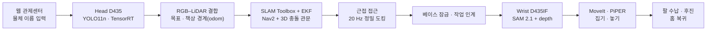

## 프로젝트 소개
이 프로젝트는 **RoboCup@Home 2027**을 위한 모바일 매니퓰레이터를 개발합니다. 로봇은 **TRACER** 이동 베이스 위에 **AgileX PiPER** 팔을 올린 구성입니다. 요청받은 물체를 책상 위에서 찾고, 그 앞에 정밀하게 도킹한 뒤, 집어서 옮깁니다. 모든 소프트웨어는 **Jetson AGX Orin**의 **ROS 2 Humble**에서 실행합니다.

이 저장소에는 전체 시스템이 들어 있습니다.
- `HW/`: 하드웨어 모델과 보정 기록
- `SW/`: 로봇 실행, 인식, 주행, 도킹, 매니퓰레이션, 웹 관제센터

## **시스템 개요**

<!-- TODO: 발표용 시스템 그림(system_overview.png)이 있으면 mermaid 대신 이미지로 교체 -->

## **하드웨어 구성**

- **이동 베이스:** AgileX TRACER (차동 구동)
- **팔:** AgileX PiPER 6자유도 팔 + 평행 그리퍼
- **메인 컴퓨터:** NVIDIA Jetson AGX Orin (JetPack 6.2, ROS 2 Humble)
- **카메라:** Intel RealSense D435 (머리), D435IF (손목)
- **LiDAR:** Livox MID-360S (3D, 1.33 m 높이에 거꾸로 장착), YDLIDAR G2 (2D)
- **센서 랙:** 알루미늄 프로파일 자체 제작 랙 ([URDF](HW/URDF/sensor_rack_description))

### 캘리브레이션 요약

| 대상 | 방법 | 결과 |
|---|---|---|
| 바퀴 오도메트리 | `/cmd_vel` 자동 주행, MID-360 점군 정합을 기준값으로 속도 모델(v4) 보정 | 직진 1 m당 5~7 mm |
| 회전 방향 | IMU 자이로 편향 제거 + `robot_localization` EKF → `/odom_ekf` | 90° 회전당 0.1° |
| Base ↔ MID-360 | 바닥 평면 RANSAC(roll·pitch·z) + 주행 걸음 점-평면 ICP(x·y·yaw) | [기록](HW/calibration/physical/base_mid360/README.md) |
| Base ↔ G2 | MID-360 기준 2D–3D 6자유도 정합 | [기록](HW/calibration/physical/base_2dlidar/README.md) |
| Head D435 ↔ MID-360 | koide3 `direct_visual_lidar_calibration`, bag 4개 | [기록](HW/calibration/head_mid360/README.md) |
| 손목 hand-eye | ChArUco 55자세, Park 초기값 + 비선형 최적화 | [기록](HW/calibration/physical/wrist_handeye/README.md) |
| 카메라 내부 파라미터 | 카메라별 체커보드 11×8칸(2.5 cm) | [기록](HW/calibration/camera_intrinsics/README.md) |

## **패키지 구성**

- 🤖 **로봇 실행 · 안전**
  - [SW/robot](SW/robot) - 실물 센서, 센서 TF, EKF 오도메트리, 베이스 잠금
  - [SW/robot/collision_processing](SW/robot/collision_processing) - 모든 `/cmd_vel`을 검사하는 3D 충돌 관문, Nav2 장면·경로 레이어, 보호 후진

- 🖥️ **관제센터 · Task**
  - [SW/control_center](SW/control_center) - 웹 대시보드, SLAM/Nav2 모드, Head–LiDAR 목표 결합, 근접 접근 도킹, 전체 Task 상태 머신

- 👁️ **인식 · 비전**
  - [SW/detection/head](SW/detection/head) - 6종 YOLO11n(green_apple, peach, tomato, fanta_can, cup, banana), 젯슨 TensorRT FP16
  - [SW/detection/wrist](SW/detection/wrist) - 손목 인식 안내 문서(SAM 2.1 Tiny + aligned depth)

- 🦾 **매니퓰레이션**
  - [SW/manipulation](SW/manipulation) - 손목 SAM 기하 계산, MoveIt 계획, PiPER 실행, 접시 배치

- 🎮 **시뮬레이션**
  - [SW/simulation](SW/simulation) - Gazebo Harmonic·MuJoCo 환경, 통합 URDF, 시뮬레이션 보정

- 📐 **하드웨어 · 보정**
  - [HW/URDF](HW/URDF) - TRACER, PiPER, 센서 랙, 손목 카메라 모델(CAD, 메시, 관성)
  - [HW/calibration](HW/calibration) - 실물 로봇 보정 원본과 적용 기록

- 📊 **데이터셋**
  - [Head 데이터셋 20261013](SW/detection/head/datasets/20261013/README.md) - 2,155장(train 1,786 / val 369), 검증 mAP50 0.975

- 🛠️ **설치 · 도구**
  - [SW/setup](SW/setup) - 젯슨 설치와 버전 기록
  - [SW/tools](SW/tools) - 저장소 관리 도구
