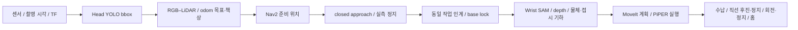

# 발표 준비 — 무엇을 왜 사용했고 어디까지 검증했는가

2026-10-16 통합 소스 기준. 발표의 중심은 기술 이름 나열이 아니라 **센서 입력 → 좌표/목표 → 차체 접근 → 손목 관측 → 팔 동작 → 복귀**의 데이터 흐름이다. [저장소 첫 페이지](../README.md), [최신 통합 기록](CHANGES_20261016.md), [전체 Task 조건](control_center/TASK.md)을 먼저 읽는다.

## 1. 첫 1분에 설명할 전체 흐름

“TRACER 위의 PiPER와 두 RealSense, 2D/3D LiDAR를 사용했다. Head YOLO11n으로 대상을 찾고, 영상과 LiDAR를 촬영 시각의 좌표계로 연결해 목표와 책상 경계를 얻는다. Nav2와 별도의 정밀 접근 제어로 팔이 닿는 위치에 정지한다. 베이스를 잠근 뒤 Wrist SAM 2.1 Tiny와 aligned depth로 물체/접시를 재관측하고 MoveIt·PiPER로 집기/배치를 연결한다. 팔 수납 후 직선 이탈·정지·회전·정지를 거쳐 홈 복귀를 요청한다. 전체 Task 코드는 연결됐지만 접시 관측 자세와 실측 프로파일 검증이 남아 있다.”



전체 Task의 “구현”과 “전체 실물 성공”을 같은 말로 쓰지 않는 것이 첫 원칙이다.

## 2. 우선순위와 읽을 코드

| 순서 | 공부할 내용 | 설명할 수 있어야 하는 질문 | 읽을 곳 |
|---:|---|---|---|
| 1 | 시스템 구조·실행 소유권 | 어떤 노드가 관측하고 어느 모듈이 실제 속도·팔 명령을 내는가? | [TASK](control_center/TASK.md), [MANIPULATION](control_center/MANIPULATION.md) |
| 2 | 좌표계·timestamp·보정 | 픽셀 한 점을 어떻게 odom의 3D 위치로 바꾸며 왜 최신 TF를 그냥 쓰면 안 되는가? | [head_lidar.py](control_center/head_lidar.py), [sensor_tf.py](robot/sensor_tf.py) |
| 3 | YOLO·TensorRT·평가 | 학습/추론, bbox/confidence/NMS, FP16, 검증 mAP와 실제 성공률은 어떻게 다른가? | [Head](detection/head/README.md), [TensorRT](detection/head/TENSORRT_JETSON.md) |
| 4 | SLAM·Nav2·closed approach | 지도 이동만으로 왜 책상 앞 정밀 정렬이 끝나지 않는가? | [DETECTION](control_center/DETECTION.md), [detection_approach.py](control_center/detection_approach.py) |
| 5 | Wrist SAM·depth·파지 기하 | SAM이 클래스 분류를 하지 않는데 목표를 어떻게 고르는가? | [Wrist](detection/wrist/README.md), [wrist_frontend.py](manipulation/manipulation_ws/src/robocup_real_manipulation/robocup_real_manipulation/wrist_frontend.py) |
| 6 | URDF·FK/IK·TCP·MoveIt | 광학 원점·link6·TCP·파지 중심은 어떻게 다른가? | [URDF](../HW/URDF/README.md), [CALIBRATION](manipulation/docs/CALIBRATION.md), [motion.py](manipulation/manipulation_ws/src/robocup_real_manipulation/robocup_real_manipulation/motion.py) |
| 7 | 상태 머신·실패 처리·검증 | 입력/통신이 끊기거나 중복 요청이 오면 어떻게 멈추는가? | [task_control.py](control_center/task_control.py), [충돌 보호](robot/collision-avoidance.md), [CHANGES](CHANGES_20261016.md) |

처음에는 각 문서의 흐름과 입출력을 설명하고, 그다음 아래 핵심 개념을 공부한다. 설치 명령 전체를 외우는 것보다 좌표·시간·검증 근거를 이해하는 것이 우선이다.

## 3. Head: 검출·학습·가속

### 알아야 할 개념

- bbox는 영상의 2D 사각형이며 곧바로 3D 위치가 아니다.
- confidence는 모델의 검출 점수다. 해당 테이블에 물체가 존재할 확률로 보정된 값이 아니다.
- NMS는 겹친 검출을 줄이는 후처리다. 현재 class별 top-1은 겹치지 않는 동일 클래스 후보도 하나만 남기는 별도 정책이다.
- IoU는 두 박스의 교집합/합집합 비율이다. Precision은 검출한 것 중 정답 비율, Recall은 정답 중 찾은 비율이다. AP/mAP는 confidence를 바꿔 얻은 precision–recall 관계를 요약한다.
- 연속 영상의 인접 프레임을 train/val에 섞으면 비슷한 장면 누출이 생긴다. 현재 데이터는 영상 단위 분할이다.
- TensorRT는 학습한 모델을 대상 NVIDIA GPU에 맞춰 빌드·추론하는 도구다. `.pt → 중간 ONNX → .engine`이며 FP16은 숫자 정밀도 선택이다.
- TensorRT가 주로 줄이는 것은 모델 계산 비용이다. 카메라/ROS/JPEG/네트워크/화면 비용은 남는다.

### 이번 프로젝트에서 말할 수 있는 수치

| 항목 | 기록 |
|---|---|
| 클래스 | green_apple / peach / tomato / fanta_can / cup / banana |
| 데이터 | 2,155장, train 1,786 / val 369, bbox 12,205 |
| 검토 상태 | 저장 315장 / 검토 완료 표시 209장. 전체 수동 검증 아님 |
| 학습 | RTX 5070 Laptop, imgsz 640, batch 4, 32 epoch에서 조기 종료, best 12 |
| 검증 | mAP50 0.97474 / mAP50–95 0.70237. 부분 검토 라벨 기준 |
| 현재 후처리 | cup/banana 0.50, 나머지 0.25, NMS 0.7, class별 top-1 |
| 엔진 | Jetson TensorRT FP16, 고정 640×640, batch 1. 대상 장치에서 생성 |
| FPS | Camera / Detection / debug Hz / 화면 FPS를 구분. 현장 25FPS 이상 보고는 통제 벤치마크 아님 |

이전 cup=0.70 영상의 “중복 컵 프레임 101→0”은 그 조건에서 얻은 결과다. 최신 0.50+top-1의 독립 정확도로 발표하지 않는다. 이전 보관 테스트 영상 두 개는 현재 학습에 포함됐으므로 새 독립 테스트가 필요하다.

## 4. 좌표·시간: 발표에서 가장 중요한 연결

영상 픽셀 `(u,v)`는 카메라 광선이다. 단순 핀홀 모델에서는 depth `z`와 내부 행렬 `fx,fy,cx,cy`로 `x=(u-cx)z/fx, y=(v-cy)z/fy`를 계산한다. 실제 영상에는 왜곡·정렬 기준이 있으므로 코드의 K/D 처리와 pixel frame을 따른다.

```text
p_odom = T_odom_sensor(t_capture) × p_sensor
T_parent_camera_root =
    T_parent_rgb_optical_measured × T_rgb_optical_camera_root_driver
```

공부할 항목은 homogeneous transform(4×4), 회전행렬/quaternion, optical 축(+Z 전방/+X 오른쪽/+Y 아래), 몸체 축, K/D와 extrinsic 차이, 좌표 변환의 곱셈 순서다.

- intrinsic: 렌즈·영상 픽셀 모델. extrinsic: 센서끼리의 상대 위치/회전.
- 움직이는 로봇의 점군/영상은 취득 시각의 odom/팔 자세로 변환해야 한다.
- 현재 Head/LiDAR는 측정 시각 odometry 이력을 보간한다. 단순 최신 TF 대체·무제한 외삽을 하지 않는다.
- 현재 RGB는 원본 토픽이다. calibrated_streams는 CameraInfo만 발행한다.
- factory RGB 기준 aligned depth에는 해당 factory CameraInfo를 사용한다. 다른 실측 K/P와 임의로 섞지 않는다.
- sensor_tf의 최신 55자세 ChArUco와 manipulation 프로파일의 이전 best15 값은 별도 입력이다. 자동으로 같아지는 구조라고 말하지 않는다.

## 5. SLAM·Nav2와 정밀 도킹

SLAM Toolbox는 지도와 map↔odom 관계, EKF는 odom↔base_link, Nav2는 경로/주행을 담당한다. **map은 위치 보정으로 바뀔 수 있고 odom은 국소 이동의 연속성 기준**이라는 차이를 설명할 수 있어야 한다.

책상 앞 목표에는 물체 점 하나 외에도 작업면 높이·경계·법선·차체 외곽·팔 도달 위치가 필요하다. MID-360 경계를 추정하고, 물체를 팔 선호 오프셋 쪽에 놓는 차체 자세를 만든다. 현재 선호 오프셋을 사전 계산된 IRM이라고 설명하지 않는다.

현재 정밀 접근은 웹 영상 작업과 분리한 20Hz 목표 제어다. 책상 edge를 실측 갱신하고, 센서 사각에서는 마지막 확인 경계를 제한적으로 고정해 odometry로 마무리한다. 기록된 완료 조건은 전후 1.5cm·좌우 2cm·heading 2°·책상 간격 0–3cm와 실제 정지 확인이다. 이 값은 설정/구현 조건이며 실제 도킹 오차 실측 표가 아니다.

실패 시 정지·관측 대기·제한된 직선 후진 복구가 있다. 일반 Nav2 목표 도착과 팔 작업 인계 완료를 같은 상태로 처리하지 않는다. [현재 조건과 예외](control_center/DETECTION.md).

## 6. Wrist·파지

현재 기본은 SAM 2.1 Tiny 자동 마스크다. SAM은 “이것이 banana”라고 분류하지 않는다. 요청된 Head 클래스/coarse 위치·depth·크기 조건으로 후보를 골라야 한다. class confidence와 SAM predicted IoU를 같은 점수로 설명하지 않는다.

알아야 할 흐름:

1. RGB/depth/CameraInfo 동기화와 신선도 검사.
2. SAM mask → 유효 depth 선택 → 카메라 3D → 촬영 시각의 작업 좌표계.
3. 물체 후보 크기·coarse 위치 대응·중복/모호함 검사.
4. 바나나 PCA 주축을 실제 두꺼운 몸통 픽셀의 파지점으로 옮기기. 초승달 실루엣 중심의 빈 공간을 잡지 않기.
5. 접시는 Head의 클래스가 아니다. SAM mask의 형태·실측 크기/높이·빈 평면 공간으로 관측한다.
6. MoveIt IK·궤적·충돌 검사 → PiPER 명령 → 실제 feedback/그리퍼 접촉 판단.

현재 방식은 탑다운 기하 기반 파지와 MoveIt를 사용하며 GraspNet이 실행 의존성이 아니다. SAM 모델 교체만으로 파지 성공이 보장되지 않는다.

## 7. 팔·차체 실행 계약

- FK: 관절값으로 말단 자세 계산. IK: 말단 목표를 만족하는 관절값 구하기.
- TCP는 도구 기준점이고 camera optical은 카메라 투영 기준점이다. 둘의 변환과 파지 중심 오프셋을 구분한다.
- 모델 joint1 origin yaw +1.6rad 때문에 feedback bridge는 q1에서 1.6rad를 뺀다. 임의 영점 보정/제어 오차 은폐가 아니다.
- URDF visual, collision, inertial은 각각 외형·충돌·질량/관성이다. 정교한 외형이 실제 충돌/동역학 정확도를 보증하지 않는다.
- MoveIt는 자기/몸체·테이블·장애물·부착 물체를 포함한 계획을 검사한다. 현재 구현의 연속 spline과 실제 스트리밍 경로 검사를 구분해 읽는다.
- 100Hz 팔 스트리밍은 목표 주기다. 실제 달성은 계측이 필요하다.
- base lease/작업 ID는 도킹·팔·이탈 단계가 같은 작업인지 확인하는 계약이다. heartbeat/feedback 만료 때 이전 명령을 재생하지 않는다.
- 최종 Tracer 출력의 guard/watchdog/잠금은 UI 버튼과 별개의 실행 경계다.

## 8. 예상 질문과 답의 핵심

| 질문 | 답변의 핵심 |
|---|---|
| 왜 Head와 Wrist 두 카메라를 쓰나? | 전역 탐색 시점과 근거리 파지 시점의 가림·해상도·팔 움직임이 다르다. Head coarse와 Wrist 재관측을 연결한다. |
| YOLO confidence 0.9면 90% 확률인가? | 해당 점수의 calibration을 검증하지 않았다. 테이블 존재 확률이나 성공률로 직접 쓰지 않는다. |
| 왜 YOLO11n인가? | 작은 모델을 실시간 배포의 출발점으로 fine-tuning했다. 최고 모델임을 비교 검증한 것은 아니다. |
| TensorRT는 모델을 새로 학습하나? | 학습된 연산을 GPU용 engine으로 빌드/실행한다. FP16 수치 변화는 결과 대조가 필요하다. |
| cup 중복은 NMS로만 해결했나? | 과거 threshold 실험 후 현재는 class별 top-1도 사용한다. 복수 동일 물체를 숨기는 한계가 있다. |
| 검증 mAP가 높으면 실물도 잘 되나? | 부분 검토 라벨·촬영 분포 기준 지표다. 새 거리/조명·시점의 독립 평가가 필요하다. |
| SAM에 클래스가 없는데 물체를 어떻게 찾나? | Head 요청 클래스/coarse 위치와 mask의 기하·depth/크기로 후보를 연결한다. |
| 접시 클래스가 없는데 배치는 어떻게 하나? | Wrist SAM의 형태·크기·height·빈 영역으로 찾는다. 모호한 접시는 거절한다. |
| 최신 TF를 쓰면 안 되나? | 이동 중에는 촬영 시각과 현재 위치가 다르다. 이력 보간과 시간 일치가 필요하다. |
| calibrated URDF를 실물에 켜면 끝인가? | 실물 arm 부분 URDF와 실측 sensor TF 경로가 별도다. 중복 발행/시뮬레이션 보정 혼합을 피한다. |
| 전체 작업이 실물에서 성공했나? | 코드 통합·과거 정차 실험·회귀 검사는 있다. 최신 전체 Task의 실물 완료는 아직 확인하지 않았다. |
| 남은 가장 큰 항목은? | 실측 접시 관측 자세/프로파일 commissioning, 보정 일치, 클래스별 파지와 전체 이동·인계의 현장 검증. |

## 9. 발표 자료에 준비할 증거

- 전체 데이터 흐름 그림 한 장, 실제 모듈/ROS 토픽·좌표계 그림 한 장.
- 현재 설정과 커밋, 학습 조건·split·라벨 검토 범위를 함께 적은 지표 표.
- 저장된 검출 영상과 실제 장치 FPS 로그. 추론 FPS와 표시 FPS를 구분.
- 과거 성공 실험이 무엇인지와 최신 전체 Task에서 남은 항목을 분리한 상태 표.
- 질문을 받으면 관련 코드/설정·실험 원본을 열 수 있는 링크.

테스트 통과 개수, Gazebo의 수치 잔차, SAM predicted IoU, 설정 주기를 실물 성공률·mm 정확도·보장 FPS로 바꾸어 발표하지 않는다.
