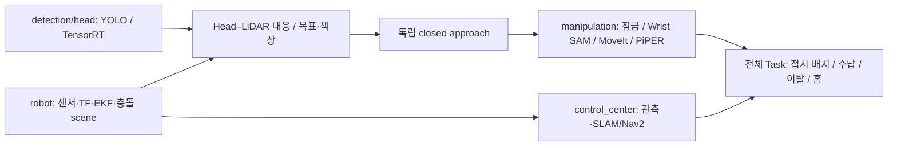

# Software · INHA United @Home 2027

2026-10-16 main 기준 실행·개발 경로 안내다. 날짜가 붙은 설치/실험 기록은 당시 결과이며 현재 통합 성공을 뜻하지 않는다.

## 시작 문서

| 목적 | 문서/진입점 |
|---|---|
| 전체 구조를 이해하고 발표 준비 | [공부 순서·개념·예상 질문](PRESENTATION_STUDY_GUIDE.md) |
| 실물 센서·관절 피드백·TF | [robot/README](robot/README.md), `robot/start_robot.sh` |
| 웹 관제 실행 | [control_center/README](control_center/README.md), `control_center/jetson-center.sh` |
| RGB–LiDAR 목표 대응·책상 정밀 접근 | [DETECTION](control_center/DETECTION.md) |
| 팔·도킹 인계 | [MANIPULATION](control_center/MANIPULATION.md) |
| 접시에 배치 후 홈 복귀 | [TASK](control_center/TASK.md) |
| Head 모델·데이터·학습 | [Head](detection/head/README.md), [training](detection/head/training/README.md) |
| 현재 Wrist SAM 실행 코드 | [Wrist 진입 문서](detection/wrist/README.md), [manipulation](manipulation/README.md) |
| 충돌 보호·속도 출력 | [collision-avoidance](robot/collision-avoidance.md) |
| 시뮬레이션 | [simulation](simulation/README.md), [모델 종류](simulation/robot_description/README.md) |
| Jetson 최초 설치/기록 | [setup](setup/README.md), [설치 버전](setup/jetson/VERSIONS.md) |
| 삭제/보존 판단과 Git 복구 | [저장소 유지관리](REPOSITORY_MAINTENANCE.md) |

## 현재 모듈 연결

현재 Head/LiDAR 실행과 도킹 제어는 `control_center`에 있고 공통 YOLO adapter·모델은 `detection/head`에 있다. 현재 Wrist ROS frontend는 `manipulation`에 있다. `detection/head/head_detection_ws`의 기존 상태 머신/시뮬레이션 노드를 관제 전체 Task와 같은 실행기로 설명하지 않는다.

## 실제 사용 환경

실물은 Ubuntu 22.04 / ROS 2 Humble / Jetson AGX Orin을 기준으로 한다. Head TensorRT, Wrist SAM, ROS/팔 runtime은 각각 지정된 Python/overlay를 사용한다. 버전을 임의로 최신으로 덮어 설치하지 않고 [모듈별 실행 안내](control_center/TASK.md)와 [기존 가상환경 기록](setup/jetson/VIRTUAL_ENVIRONMENTS.md)을 대조한다.

- Head: `~/venvs/head_detection`, TensorRT engine은 대상 장치에서 생성.
- Wrist: 현재 `config/wrist.yaml`의 SAM 2.1 Tiny checkpoint와 실행 Python 설정.
- 팔/메시지: `manipulation/build-runtime.sh`로 동일 버전 설치. 실행 중 관제·watchdog·팔/손목 재시작은 별도 배포 단계.
- 카메라: 원본 RGB + 해당 픽셀계의 CameraInfo/depth. 보정된 K/D와 factory aligned depth를 임의로 혼합하지 않는다.

## 완료 상태를 말하는 기준

모듈 코드 존재, 오프라인 회귀 통과, ROS 통신, 과거 청사과 정차 실험, 전체 Task의 실물 완료는 각각 다른 증거다. 최신 통합의 접시 관측 자세·실물 프로파일 조건은 [TASK 현재 한계](control_center/TASK.md)에 남아 있다. 테스트 수나 설정 주기를 실제 구동 성공률/FPS로 표현하지 않는다.

[2026-10-16 통합 변경과 검증 이력](CHANGES_20261016.md). 과거 설치 샘플과 시뮬레이션 결과는 각 날짜/폴더의 기록으로 보존한다.
