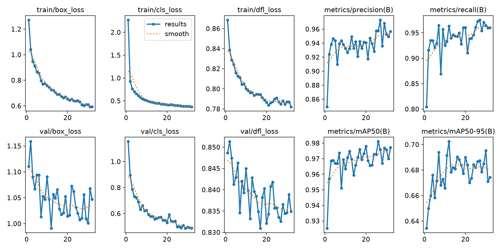

# Head YOLO11n 6클래스 재학습 완료 · 2026-10-13

현재 사용할 가중치는 [head_yolo11n_20261013.pt](../../../models/head_yolo11n_20261013.pt)다. 로컬 학습의 `best.pt`를 이름만 바꿔 게시했다. 모델 SHA256: `99a059d9b4afb8c45587ca7d031f49d3b05c787d919e6d855bf5ccb326c26b06`.

**green_apple / peach / tomato / fanta_can / cup / banana**를 직접 출력하는 새 6출력 모델이다. cup 대상은 손잡이를 포함한 빨간 머그컵만이다. 기존 20261007 7출력 모델과 당시 기록은 보존했다.

## 실제 학습 설정과 종료

- 데이터: [20261013 스냅샷](../../../datasets/20261013/README.md), train 1,786장 / val 369장.
- COCO pretrained `yolo11n.pt`에서 학습 시작. 기존 7클래스 run을 resume하지 않았다.
- GPU: NVIDIA GeForce RTX 5070 Laptop GPU, 8 GB. Python 3.12.14 / torch 2.11.0+cu128 / Ultralytics 8.4.174.
- imgsz 640, batch 4, epochs 100, patience 20, workers 2, AMP true, seed 42, cache false.
- 실제 32 epoch / 0.256시간(약 15분 22초). epoch 12 이후 20회 성능 개선이 없어 EarlyStopping으로 정상 종료.
- 최적 모델 epoch 12. 약 5.45 MB, fused 2,583,322 parameters / 6.4 GFLOPs.

## best.pt 검증

검증 이미지 369장, 정답 bbox 2,000개. 전체 수치는 [실제 results.csv](results.csv)의 epoch 12 행과 최종 콘솔 검증 결과에 일치한다. 아래 클래스별 수치는 사용자가 제공한 실제 최종 검증 로그다.

| 클래스 | Precision | Recall | mAP50 | mAP50–95 |
|---|---:|---:|---:|---:|
| 전체 | 0.932 | 0.963 | 0.975 | 0.702 |
| green_apple | 0.985 | 0.918 | 0.992 | 0.648 |
| peach | 0.959 | 0.938 | 0.943 | 0.713 |
| tomato | 0.989 | 0.988 | 0.977 | 0.687 |
| fanta_can | 0.944 | 0.972 | 0.981 | 0.813 |
| cup | 0.963 | 0.991 | 0.989 | 0.777 |
| banana | 0.754 | 0.973 | 0.967 | 0.575 |

원래 실행 설정은 [args.yaml](args.yaml)에 보존했다. 그 파일의 Windows 경로는 당시 실행 기록이며 우분투에서는 [portable 학습 실행기](../../train_local.py)를 사용한다.

## 적용 설정과 한계

[KakaoTalk 영상 전체 961프레임 비교](VIDEO_TEST.md) 후 사용자가 `cup` 최소 신뢰도 0.70, 나머지 0.25를 승인했다. 입력 imgsz 640, NMS IoU 0.7이다. 이 설정은 학습 가중치를 바꾸지 않는 추론 필터이며 위 검증 지표를 이 필터 적용 후 지표로 해석하지 않는다.

검토 완료 표시는 209/2,155장이고 자동 라벨 초안이 남아 있다. 검증 mAP는 이 라벨 기준 수치다. KakaoTalk 영상에는 bbox 정답이 없어 테스트 precision·recall·mAP를 계산하지 않았다. 실제 두 테이블 선택 정확도도 아직 측정하지 않았다.

노트북 최종 검증 로그의 inference 1.4 ms/image는 이 GPU의 배치 검증 결과다. **Jetson AGX Orin FPS는 미측정**이며 TensorRT 변환·비동기 추론·OpenCV 보조 추적의 속도 개선은 후속 작업이다. [우분투 이어서 실행](../../../UBUNTU_HANDOFF_20261013.md).

## 게시 전 코드 검증

Windows의 별도 OpenCV contrib 검사 환경에서 53개 테스트 중 52개 통과, ROS Humble이 필요한 1개 skip. native 및 legacy 모델의 cup 필터, 임계값 경계, 다른 클래스 보존, ROI 좌표·마스크 대응을 검증했다. 학습용 GPU 환경에는 OpenCV contrib를 덮어 설치하지 않았다. 저장소의 portable 영상 실행기로도 전체 961프레임을 다시 처리해 채택 결과와 동일한 예측임을 확인했다. ROS 노드 빌드·Jetson 카메라 실행은 인수인계 문서의 후속 검증 항목이다.
