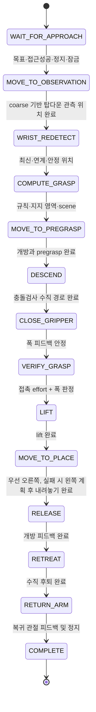

> 2026-10-15 최신 통합 실행·QoS·고정좌표·잠금 해제 ACK 계약은 [SYSTEM_INTEGRATION.md](SYSTEM_INTEGRATION.md)를 우선합니다. 이 문서는 기존 계약의 설계 이력도 포함합니다.

# 외부 모듈 계약 및 상태 머신

이 문서의 `/manipulation/*`와 `robocup_real_manipulation_msgs`는 **새로 제안·구현한 계약**이다. 현재 Tracer나 wrist detector가 이 계약을 이미 구현했다고 주장하지 않는다. 물리 드라이버 API와 계약 adapter를 구분한다.

| 이름 | 타입 | 책임 |
|---|---|---|
| `/manipulation/target` | Target | 상위 모듈: 작업 ID, 실제 class ID, instance ID, coarse 3D, frame/측정시각 |
| `/manipulation/approach_result` | ApproachResult | 내비게이션: 동일 task_id, SUCCESS/FAILED/CANCELED, base_stopped |
| `/manipulation/run` | Manipulate action | 상위 모듈: task_id로 시작 예약, feedback/result 및 표준 ROS action cancel |
| `/manipulation/base_lock_request` | BaseLease | coordinator: task_id, locked=true heartbeat. TRANSIENT_LOCAL, 재시작 시 미복구 잠금 유지 |
| `/manipulation/base_lease` | BaseLease | 내비게이션: 동일 ID, 실제 stopped/locked, 현재 timestamp. 기본 0.3초 이내 heartbeat |
| `/manipulation/wrist/request` | ObservationRequest | 안정된 팔 상태에서 새 observation_id, target class/instance/coarse 전달 |
| `/manipulation/wrist/result` | WristObservation | 인식 adapter: acquisition 시각의 전체 후보 batch, 클래스·인스턴스·품질·3D 또는 정합 depth/mask/CameraInfo |
| `/manipulation/status` | TaskStatus | 단계 진입/종료, 실패 원인, HELD/EMPTY/UNKNOWN, center/TCP, coarse↔precise 연계 거리 |
| `/manipulation/result` | TaskStatus | 최종 결과. place/return/stop 결과 분리. action 결과와 동일 |
| `/arm_controller/follow_joint_trajectory` | control_msgs/FollowJointTrajectory | MoveIt→새 Piper bridge. 실제 피드백 도달·정지 확인 |
| `/manipulation/set_width` | SetWidth action | coordinator→bridge, 실측 물리 폭(m). width/effort feedback 기반 완료 |
| `/manipulation/stop` | std_srvs/Trigger | bridge: 최신 피드백으로 현재 자세/폭 hold, 팔 정지 확인. 로봇 emergency stop을 대체하지 않음 |

작업 절차: UUID 등 재사용하지 않는 ID를 생성 → Target·ApproachResult를 각각 송신 → Manipulate goal. goal을 먼저 송신해도 된다. Target와 접근 이벤트 순서는 자유다. `SUCCESS + base_stopped + 같은 ID의 최신 잠금 heartbeat + 최신 관절 피드백`이 모두 있어야 팔 움직임을 시작한다. 접근 실패/취소는 팔 미시작 실패 결과를 반환한다.

동시 작업 정책은 **단일 작업·새 작업 거부**다. 동일 이벤트는 덮어쓰지 않는다. 완료·실패·취소된 ID는 journal에 보관해 재시작 후 replay도 거부한다. cache는 최대 64개다. 접근 완료 시각은 목표 측정시각과 다르며, 각 freshness 기준을 별도로 검사한다. 미복구 실패가 있으면 다음 goal도 거부한다.

## 상태 전이

모든 단계에는 cancel·베이스 heartbeat·관절 최신성 검사가 있다. WAIT는 `approach_timeout_s`, 재관측은 `observation_timeout_s`, 모션·그리퍼는 `stage_timeout_s`, 정지 확인은 `stop_timeout_s`를 사용한다. coarse 좌표 위의 탑다운 관측 TCP 목표는 실측 link6↔TCP↔카메라 관계와 optical 관측 거리로 계산한다. 선택적 관절 중간 자세를 거쳐도 최종 관측은 이 목표에서 수행한다. 카메라 광축이 물체 중심을 향하며 TCP는 물체 위에 있어야 한다. 관측 이동 완료 뒤 관절 속도가 `stable_speed_rad_s` 아래로 `joint_stable_s` 지속되어야 acquisition 요청을 보낸다. sleep은 polling 간격에만 사용하고 완료 판정에는 사용하지 않는다.

retry는 손목 관측에만 `observation_retries`회 허용한다(기본 추가 1회). retry마다 새 observation_id로 바꾼다. 팔 하강·그리퍼 닫힘·release·place 등 물리 모션은 자동 재시도하지 않는다. 이전 요청의 wrist 응답과 acquisition 이전 영상은 거부한다.

## 손목 인식 adapter

기본 연결 방식은 사용자가 질문한 **3번: 카메라 기준 입력 → 매니퓰레이션에서 변환**이다. 디텍션은 카메라 optical 기준 위치·종류·방향·capture timestamp·품질을 전달한다. 매니퓰레이션이 hand–eye와 취득시각의 관절 TF로 팔 기준 위치를 만들고, TCP/tool 관계와 파지 규칙으로 팔 기준 TCP 목표를 만든다. 디텍션 쪽에서 EE/TCP까지 변환할 필요가 없다.

인식 모델의 내부 추론은 외부 모듈의 책임이다. existing wrist 실험 코드는 ROS request/result 서버가 아니므로 그 결과를 위 계약으로 송신하는 부분을 연결해야 한다. `node.py`는 수신 경계에서 형식·시각·단위·TF·품질 검사를 구현한다.

- header는 RGB/depth **취득 시각**과 optical frame. 추론 종료 시각으로 바꾸지 않는다.
- 같은 acquisition에서 모든 후보를 `candidate_count`, `candidate_index=0..count-1`로 보낸다. 모두 도착하기 전에는 연계를 결정하지 않는다. 관련 없는 클래스 후보도 count에 포함할 수 있다.
- 알려진 cross-camera instance ID가 있으면 클래스·ID·위치 gate를 모두 만족해야 한다. 헤드 tracking ID가 손목 ID와 의미가 다르면 `instance_id=''`로 위치 기반 계약을 선택하고 요청의 coarse 위치를 사용한다. 임의로 같은 ID를 붙이지 않는다.
- instance ID가 없으면 같은 클래스 후보의 가장 가까운 기하 중심을 선택한다. 기본 12cm 이내, 1·2위 거리 차 2cm 이상이어야 한다. 동일 클래스의 모호한 배치는 거부한다.
- `has_position=true`: CENTER/SURFACE를 명시하고 검증된 `position_std_m`를 제공한다. CENTER는 실제 기하 중심 추정값이어야 한다.
- `has_position=false`: 같은 capture의 rectified RGB optical frame에 정합한 depth(16UC1=mm, 32FC1=m), mono8 target mask, CameraInfo를 모두 제공한다. D=0인 rectified K와 일치하는 resolution을 사용한다. bbox 중심의 단일 depth는 지원하지 않는다.
- mask erosion → mask 중앙 patch → 유효 depth 비율 → median/MAD → outlier 제거 → deprojection. 이는 배경 섞임을 줄이는 초기 조건이며 임의 시점의 구 표면으로부터 정확한 중심을 복원하는 solver가 아니다.
- 기본 3개 독립 취득 프레임의 중심이 설정된 편차 이내여야 한다. 팔 안정·TF 취득시각·confidence·위치 std 검사도 함께 수행한다.
- 바나나는 gravity frame의 장축 `axis_yaw`와 `axis_valid=true`가 필요하다. 외부 인식에서 mask/PCA 또는 별도 방향 측정을 구현하기 전에는 바나나 파지가 실패한다. 같은 class ID와 중심만으로 yaw를 만들어내지 않는다.

외부 연결 예시는 `test_sender.py`의 Target·ApproachResult·action client·lock 응답·wrist 응답을 참고한다. test_sender의 정지/위치 값은 합성이므로 실제 베이스나 디텍터 adapter로 배포하지 않는다.

## 실패/취소 결과

UNKNOWN은 닫힘 명령을 시작했지만 접촉을 확인하지 못한 상태다. HELD 이후에는 place 불가능/취소라도 열거나 자동 복귀하지 않는다. release의 실제 개방 피드백이 확인되면 EMPTY와 place_success를 기록하고, 이후 scene 갱신 또는 복귀가 실패하면 전체 FAILED로 반환한다.

실패 시 진행 중 action을 cancel하고 bridge hold를 요청한다. 정지가 확인되지 않으면 `stop_confirmed=false`로 기록하며 실제 emergency stop과 현장 확인이 필요하다. 베이스 잠금은 결과와 별개로 유지한다. 수동 복구 뒤에는 프로세스를 정지하고 journal의 `locked_task`만 비워 재시작한다. `completed` ID 목록은 지우지 않는다. 물체를 보유한 채 이 잠금을 자동 해제하는 recovery 서비스는 제공하지 않는다.
