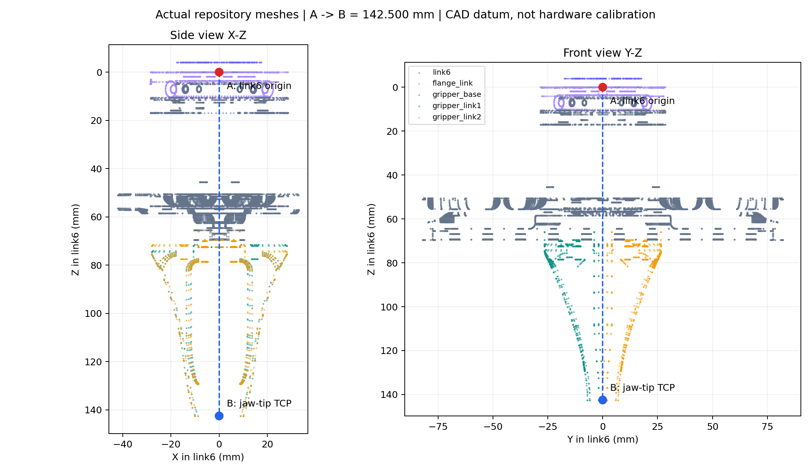

# EE(link6) → TCP: CAD 확인과 실물 보정

## 확인한 두 점



- **A(빨강)**: `piper_link6` 좌표계 원점. `piper_flange_joint`가 xyz/rpy=0이므로 `piper_flange_link` 원점과 같다. 메시의 무게중심이나 그리퍼 연결판 중앙을 뜻하지 않는다. 어느 실물 표면인지 확인하지 않은 상태에서 판 표면을 A라고 가정하지 않는다.
- **B(파랑)**: 기존 시뮬레이션이 정의한 **손가락 끝 높이의 중심축 점**. 실제 STL의 link6 +Z 방향 최대 높이를 두 손가락에서 각각 구하고 평균을 취한다. 그 높이의 x=y=0인 점이 B다. 접촉 패드의 면적 중심이나 손가락 사이 공간 전체의 중심은 아니다.
- 현재 원본 모델의 A→B는 `[0, 0, 0.1425000002] m`, 축은 link6와 평행(`quaternion_xyzw=[0,0,0,1]`)이다. 이는 CAD 기준값이며 현재 실물의 정확도를 증명하지 않는다. 손가락 팁 리비전이 바뀌면 재확인한다.

실물에서도 이 B를 TCP로 유지하고, 물체별로 TCP 목표 높이(`grip_height_m`)를 조정하는 방식을 권한다. 이 정의에서 `tcp_to_grip_center_m=[0,0,0]`은 선택한 파지 기준점을 B로 사용할 때만 설정한다. 패드의 더 안쪽 지점을 파지 기준으로 사용할 경우 B와 그 지점 사이의 **TCP 로컬 오프셋**을 측정해 넣거나 TCP 자체를 재정의한다. 두 방법을 동시에 적용해 중복 보정하지 않는다.

Linux의 저장소 메시/URDF만으로 그림과 기준값을 재생성할 수 있다. Fusion/Windows는 필수 조건이 아니다. 아래 명령은 저장소 `INHA-RoboCup-Home-2th-2027` 루트에서 실행한다. 일반 설치는 [DEPLOYMENT.md](DEPLOYMENT.md)를 따른다.

```bash
source /opt/ros/humble/setup.bash
source ~/piper_ros/install/setup.bash
source SW/manipulation/manipulation_ws/install/setup.bash
ros2 run robocup_real_manipulation tcp_calibration cad \
  --urdf SW/simulation/robot_description/robocup.urdf \
  --output /tmp/tcp_cad_new.json
```

`--plot /tmp/tcp_cad_new.png`를 추가하면 그림도 생성한다. 그림 생성만 `python3-matplotlib`가 필요하며 Jetson의 수집/계산에는 필요 없다. 출력 파일이 이미 있으면 덮어쓰지 않는다.

## 실물에서 필요한 준비

이 도구는 **팔 이동·모터 enable·그리퍼 명령을 보내지 않는다**. 운영자가 제조사에서 확인한 수동 조작/저속 조그 방법으로 자세를 잡는다. 베이스와 기준 지그는 고정하고, 매니퓰레이션 coordinator는 정지시켜 자동 작업을 받지 않게 한다.

1. 팔의 실제 관절 zero/sign과 URDF 대응을 확인한다. `robot.yaml` 사본의 `joint_signs`, `joint_offsets`, `joint_limits`, `joint_names`, `feedback_topic`을 채운다. 카메라 hand–eye/TCP/commissioning 값은 이 수집 단계에 필요하지 않다. 전체 config의 하드웨어 실행 flag를 켤 필요도 없다. FK는 `q_URDF = sign*q_driver + offset`을 사용한다.
2. [Piper 피드백 패치](../tools/piper_feedback.patch)를 검토·적용하고 실제 관절 취득시각이 제공되는지 확인한다. 팔 피드백은 고속 상태 메시지의 시각으로 대신 갱신되면 안 된다. ROS 시계와 취득시각도 맞춰야 한다.
3. 그리퍼에 **단단히 고정되는 보정용 프로브/지그**를 준비한다. TCP는 허공이라 그대로 접촉할 수 없다. 손가락에 흔들리는 펜을 임의로 끼우는 것으로 정확한 보정이 되지 않는다. 장착/폭이 변해도 움직이지 않는 고정 지그와 뾰족한 끝 또는 반복 접촉 가능한 형상이 필요하다.
4. 프로브 끝 P와 원하는 TCP B 사이의 관계를 치수로 정한다. `--probe-offset-tcp dx dy dz`는 **TCP 좌표로 표현한 B→P 벡터(m)**다. P=B가 실제로 성립하는 지그일 때만 `[0,0,0]`을 사용한다. 임의로 더 긴 프로브를 달고 0을 입력하면 그 프로브 끝이 TCP가 된다.
5. 고정된 기준점/소켓 C를 준비한다. C의 로봇 기준 좌표는 몰라도 된다. 항상 같은 프로브 점 P를 같은 C에 저속·가벼운 접촉으로 맞춘다. 과도한 접촉력이나 변형은 오차를 만든다. 접촉 확인은 운영자가 수행하며 이 코드가 힘 센서로 자동 확인하지 않는다.
6. TCP 축을 따로 확인한다. 기존 CAD 축을 유지한다면 TCP 축을 link6 축과 평행하게 정의한다. 실제 지그/그리퍼가 이 정의와 일치하는지 확인하고 `--quaternion 0 0 0 1`을 사용한다. 다른 축을 택하면 그 회전을 직접 측정해 xyzw로 입력한다. pivot 위치 데이터만으로 회전이 보정되지는 않는다. 앞서 예시로 제안한 “+X=닫힘 방향”을 CAD 축과 혼용하지 않는다.

## 1. 실제 관절 자세 수집

train은 최소12개, 별도 holdout은 최소4개다. 권장 초기 구성은20개+6개다. 프로브 점은 그대로 두고 팔의 roll/pitch 등 **여러 축 방향을 충분히 바꿔** 자세를 수집한다. 한 축 회전만 반복하거나 팔 위치만 바꾸면 위치를 결정할 수 없거나 불안정해진다. 도달하지 못하는 자세로 억지로 움직이지 않는다. 각 자세에서 운영자가 접촉을 확인한 후 아래 명령을 한 번 실행한다.

```bash
ros2 run robocup_real_manipulation tcp_calibration record \
  --urdf SW/simulation/robot_description/robocup.urdf \
  --config /path/to/robot_measurement.yaml \
  --dataset /path/to/tcp_session_01.json \
  --fixture-id rigid_probe_v1 --split train --contact-confirmed
```

다른 자세마다 동일 명령을 반복한다. **같은 자세에서 반복 실행한 개수를 서로 다른 자세 수로 취급하지 않는다.** holdout 자세에서는 `--split holdout`을 쓴다. 지그나 기준점/베이스/폭을 바꾸면 새 session 파일과 fixture ID로 시작한다.

기본1초 동안 최소10개의 서로 다른 fresh 관절 시각, 프레임 간격≤0.2초, 전체 관절 편차≤0.001rad, 추정 속도≤0.01rad/s를 검사한다. `--stable-s`, `--max-spread`로 관측 조건을 조정할 수 있다. 20초 안에 안정 상태를 얻지 못하면 저장하지 않는다. 오래된/역행 시각·중복 시각·잘못된 관절값은 완료로 간주하지 않는다. 실제 raw 관절값·취득시각·변환된 평균 관절값·FK 행렬·URDF hash를 session에 보존한다. 실제 TCP의 공간 오차는 이 관절 안정 조건만으로 보장되지 않는다.

## 2. 위치 보정 계산과 검증

각 자세의 `R_i p_probe + t_i = C`를 최소제곱으로 풀어 link6에서 본 프로브 끝과 고정 기준점 C를 함께 추정한다. 프로브 끝→TCP의 실측 관계는 `p_TCP = p_probe - R_link6_TCP * offset_TCP`로 반영한다. holdout은 계산에 사용하지 않고 검증에만 사용한다.

```bash
ros2 run robocup_real_manipulation tcp_calibration solve \
  --dataset /path/to/tcp_session_01.json \
  --quaternion 0 0 0 1 \
  --probe-offset-tcp 0 0 0 \
  --orientation-source "CAD axes parallel to link6; physically checked" \
  --axes-verified --contact-geometry-verified \
  --max-error-mm 3 --max-condition 100 \
  --output /path/to/tcp_result_01.json
```

예시 offset=0은 **P=B인 지그에만 해당**한다. 준비한 지그의 실제 값으로 바꾼다. `--axes-verified`, `--contact-geometry-verified`는 실제 확인 후 사용하며 측정을 대신하지 않는다. 초기 잔차 기준3mm는 조정 가능한 합격 기준이며 로봇 정확도 보증값이 아니다. rank 부족/조건수 초과는 방향 다양성 부족으로 실패한다. train 또는 holdout 최대 잔차가 기준을 넘으면 failed 결과를 저장하고 종료코드2로 끝난다. 실패 결과는 설정에 적용할 수 없다.

통과해도 잔차는 **현재 URDF FK에서의 반복 일관성**이다. 관절 zero/link 길이 오류, 휘어짐, 프로브 치수 오류, 절대 위치 정확도를 모두 보정한 결과가 아니다. 다른 기준점에서 재현성 확인 및 실제 파지 위치 대조가 필요하다. 보정 뒤 지그를 제거하고 여러 개방 폭에서 선택한 중앙이 유지되는지도 확인한다.

## 3. 실행 설정에 반영

```bash
ros2 run robocup_real_manipulation tcp_calibration apply \
  --urdf SW/simulation/robot_description/robocup.urdf \
  --result /path/to/tcp_result_01.json \
  --config /path/to/robot_measurement.yaml \
  --output /path/to/robot_with_tcp.yaml --tcp-verified
```

새 YAML에 **`link6_tcp_transform`만** 반영한다. 원본 설정과 모든 다른 값/flag는 유지한다. CAD/synthetic 결과, 잔차 실패, 축·지그 미확인 결과와 수집 이후 변경된 URDF·관절 sign/offset은 거부한다. `calibration_verified`, `commissioned`, `execution_enabled`는 자동으로 켜지지 않는다. 출력 YAML은 주석을 재생성하지 않으므로 설정 원본의 `[CALIB:TCP]` 주석도 참고한다.

2026-10-12 기본 설정에는 기존 실물 hand–eye와 사용자 동일 장착 조건의 CAD base/TCP를 이미 반영했다. CAD TCP142.5mm를 초기 기준으로 사용할 수 있으며 이 pivot 절차는 실물 오차를 줄이기 위한 보완 도구다. 실제 pivot 결과가 생기면 그 값으로 교체한다. 두 변환은 같은 piper_link6 기준이다. 이번 작업에서 새 실물 pivot을 수행한 것은 아니며, 그리퍼 폭·관절 대응·작업 공간 등 남은 값을 확인한 뒤 실물 기동한다.
